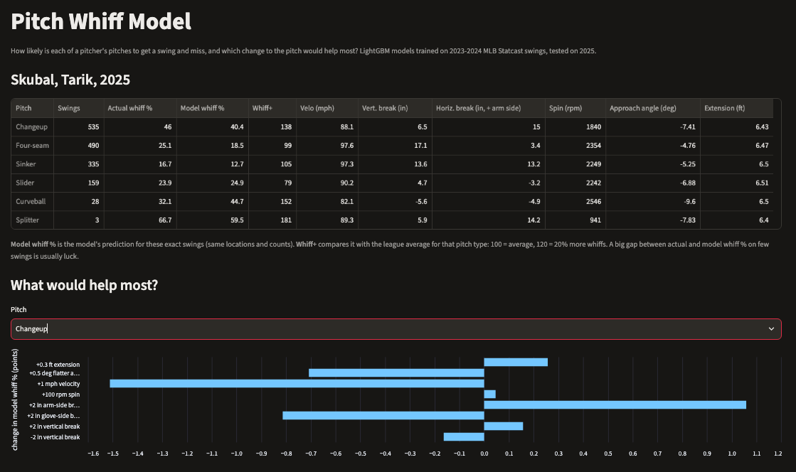

# Pitch Whiff Model

This project builds a model that predicts the chance a swing misses, based on
the pitch's physical traits, using every MLB swing from 2023–2025. A dashboard
grades each pitch in a pitcher's arsenal and shows which change would most
increase his whiffs.

## The question

When developing a pitcher, coaches have to choose what to train: velocity, command, secondary pitches, spin rate. But their effects overlap and differ from pitch to pitch, so it's hard to know which change would actually produce more swings and misses. This project asks: which physical traits of a pitch drive whiffs, and how much would changing one of them help a specific pitcher?

## Key results

- **The model beats a simple baseline.** LightGBM cut log loss vs the pitch-type average by 12.7% (fastballs), 27.0% (breaking) and 16.7% (off-speed), with AUC 0.75–0.82 on the unseen 2025 season.
- **Location matters a lot.** Location + count alone reached 73–95% of the full model's gain; location was the top driver for breaking and off-speed pitches.
- **Fastball shape matters most.** For fastballs, pitch traits were 45% of importance, more than any other group.
- **Approach angle, with a caution.** VAA was the #1 fastball feature, but it correlates 0.78 with pitch height, so part of that is location.
- **My prediction held up, except for one feature.** I predicted velocity > vertical break > spin > extension > approach angle. The model matched positions 2–5 in order, but ranked approach angle first.

## Dashboard



Pick a season and a pitcher. The table shows each pitch's actual whiff rate, the
model's predicted whiff rate for those same swings, and **Whiff+** (100 = league
average for that pitch type, 120 = 20% more whiffs). Below it, pick one pitch to
see how its predicted whiff rate would change with one adjustment at a time, such
as +1 mph or 2 more inches of break, keeping every pitch's location and count as
it was actually thrown. Sliders let you try combinations.

For example, for Tarik Skubal's changeup the model says adding 1 mph would
*lower* its whiffs, because the pitch works through the speed gap from his
fastball, while more arm-side run would raise them.

## How it works

| Step | What | Where |
|---|---|---|
| 1. Data | ~2.15 million regular-season pitches (2023–2025) from Baseball Savant via `pybaseball`, loaded into PostgreSQL | `scripts/`, `sql/01`–`03` |
| 2. Features | SQL builds one row per swing (1,000,464 swings): whiff target, velocity, movement, spin, approach angle, extension, release point, difference from the pitcher's fastball, location and count | `sql/04`–`06`, `docs/data_notes.md` |
| 2b. Exploration | Whiff rate by velocity, vertical break and count; top sweepers | `sql/07_explore_whiffs.sql` |
| 3. Models | Separate models for fastballs, breaking balls and off-speed: baseline vs logistic regression vs LightGBM. Trained on 2023–2024, tested on 2025 | `notebooks/01_models.ipynb` |
| 4. Explanation | SHAP feature importance and effect shapes; location vs pitch traits; my pre-model prediction checked | `notebooks/02_explain.ipynb`, `docs/predictions.md` |
| 5. Dashboard | Streamlit app on the saved models | `app/streamlit_app.py` |

## Limitations

- **Predictions, not guarantees.** The model learns patterns across MLB; it can't promise how a change will play for one pitcher.
- **Nothing about the hitter** (skill, expectations, timing) is in the model.
- **Approach angle overlaps with location** (correlation 0.78 for four-seamers). A fairer version would compare it with other pitches thrown to the same height.
- **Traits move together in real life,** but the dashboard changes one at a time.

## How to run it

Requires conda and PostgreSQL.

```bash
conda env create -f environment.yml
conda activate whiff
python scripts/01_download_statcast.py        # 30-60 minutes
createdb whiff
psql -d whiff -f sql/01_create_schema.sql      # then 02 through 06 in order
# run notebooks/01_models.ipynb, then notebooks/02_explain.ipynb
streamlit run app/streamlit_app.py
```